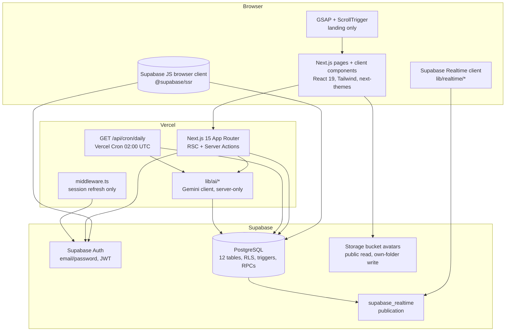
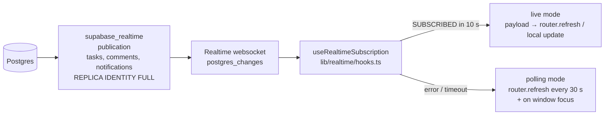
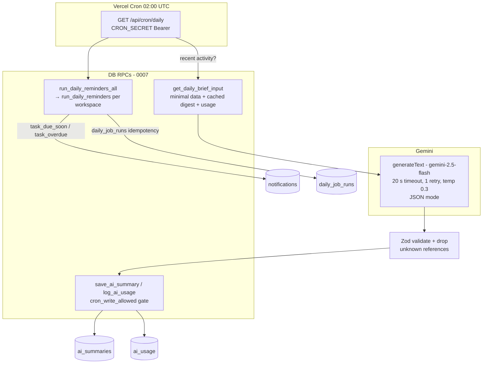
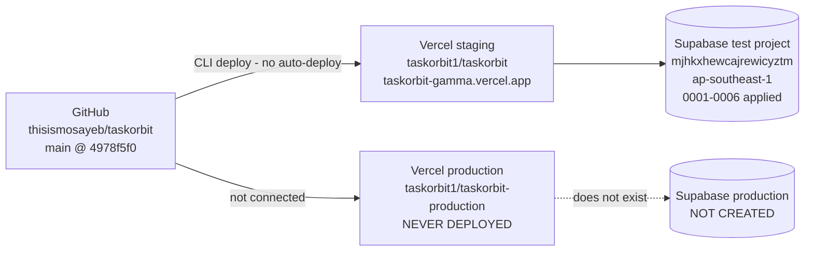

# TaskOrbit — Architecture

How the pieces fit together, as built in Parts 1–4. Everything below
is read from the actual code and migrations — file names are the
evidence. Where the code and the ideal differ, the difference is
stated plainly.

## 1. Big picture

There is **no separate backend service and no service-role key in the
app**. The Next.js server (Vercel functions) and the browser both talk
to the same Supabase project; the database itself is the enforcement
layer.

## 2. Frontend

- **App Router, React Server Components by default.** Pages under
  `app/` are server components that load data with the server Supabase
  client (`lib/supabase/server.ts`); interactive pieces are small
  `"use client"` components (`components/`). 26 pages + `/auth/callback`
  + `/api/cron/daily` = 29 routes in the production build.
- **Routing / auth shell:**
  - `middleware.ts` runs on every route except static assets; it only
    refreshes the Supabase session (`supabase.auth.getUser()`). It
    **never redirects** — redirects to `/login` / `/onboarding` live
    in layouts and pages.
  - `app/dashboard/layout.tsx` mounts the dashboard shell (sidebar,
    top bar, `RealtimeProvider`) and requires a workspace context.
  - Active workspace is a cookie, `taskorbit-workspace-id`
    (`lib/actions/workspace.ts` — the single canonical helper since
    Part 2; `lib/workspace.ts` was deleted). The cookie is only a
    preference: membership and role are re-checked on the server on
    every request via `getDashboardContext()`.
  - Locale / theme cookies: `taskorbit-locale`, `taskorbit-theme`
    (1-year, `sameSite: lax`). An existing cookie wins over the profile
    at login and is adopted into the profile (Part 3 fix — login used
    to discard a pre-login Bangla choice).
- **State:** deliberately little client state. Server components
  re-render from the database on `router.refresh()` (the polling
  fallback and the Realtime payload handlers both use it). Filters on
  `/dashboard/my-tasks` and `/dashboard/tasks` live in the URL
  (`?status=&priority=&due_from=&due_to=&sort=&mine=`), so they
  survive refresh and are shareable. The Kanban board is the exception
  — it keeps optimistic local state and reverts on server rejection.
- **i18n:** every string goes through `t()` from `lib/i18n/`; `en.ts`
  and `bn.ts` each hold 1060 keys, parity enforced by
  `tests/unit/i18n.test.ts`. Server-action validation error strings
  are the known exception — they stay English (see §7).
- **Theme:** `next-themes` (`components/theme/theme-provider.tsx`),
  Light / Dark / System, persisted in `profiles.theme_preference` and
  the `taskorbit-theme` cookie. Chart colours adapt per theme
  (`lib/theme/chart-colors.ts`); contrast is measured in
  `lib/theme/contrast.ts` (all AA, Part 3).
- **Forms:** React Hook Form + Zod (`lib/validators.ts`). Server
  actions re-validate with the same Zod schemas — client validation is
  never trusted alone.

## 3. Server (Next.js, on Vercel)

### 3.1 Server actions — `lib/actions/*`

One file per feature; each action follows the same shape:

1. `getDashboardContext()` (or `supabase.auth.getUser()`) — identify
   the user from the verified session, never from client-sent ids.
2. Role check with `lib/permissions.ts` (`canManageProjects`,
   `canManageTasks`, `canInvite`, `canDeleteComment`,
   `canChangeTaskStatus`, `canEditTaskDetails`, `canManageSubtask`,
   `canCreateSubtask`) or `lib/board-permissions.ts` for drag rules.
   A failing check returns `{ error }` and **no data**.
3. Zod validation of the input.
4. A Supabase call as the signed-in user — RLS and triggers enforce
   the same rules again in the database, so a forged direct call is
   still blocked.
5. `revalidatePath(...)` for the affected pages.

| File | Actions |
|---|---|
| `lib/actions/workspace.ts` | `getDashboardContext`, `getCurrentUser`, `setActiveWorkspace`, `createWorkspace`, `renameWorkspace`, `logOutAction` |
| `lib/actions/projects.ts` | `createProject`, `updateProject`, `deleteProject` (manager only) |
| `lib/actions/tasks.ts` | `createTask`, `updateTask`, `deleteTask`, subtask create/update/delete, status changes |
| `lib/actions/comments.ts` | `addComment`, `updateComment`, `deleteComment` |
| `lib/actions/team.ts` | `createInvite`, `revokeInvite`, `recreateInvite`, `removeMember` (via RPC), invite activity writes |
| `lib/actions/board.ts` | `moveTask` (status change via drag), `reorderTasks` (manager only) |
| `lib/actions/calendar.ts` | `getCalendarTasks` |
| `lib/actions/search.ts` | `searchWorkspace` (projects/tasks/members, active workspace only) |
| `lib/actions/notifications.ts` | `getUnreadCount` (exact), list, `markNotificationRead`, `markAllNotificationsRead` |
| `lib/actions/activity.ts` | `getActivity` (filters, 20/page) |
| `lib/actions/analytics.ts` | `getAnalytics` — manager only, aggregated server-side |
| `lib/actions/ai.ts` | `generateAiFeature` — role gate, minimised input, cache/limits |
| `lib/actions/avatar.ts` | `saveAvatarUrl` — URL validation only; bytes go straight to Storage |
| `lib/actions/preferences.ts` | theme / locale preference persistence |
| `lib/auth/actions.ts` | `signUp`, `logIn`, `logOut`, forgot/reset, `syncPreferenceCookies`; in-memory per-IP attempt guard (5 / 10 min) |

### 3.2 Route handlers

Only one: `app/api/cron/daily/route.ts` (`GET`, `runtime = "nodejs"`,
`dynamic = "force-dynamic"`). It is protected by `CRON_SECRET`
(`lib/ai/cron-auth.ts` — constant-time-ish exact match on
`Authorization: Bearer <secret>`; no secret → 401, wrong secret →
401, verified live). It uses the **publishable-key client with no
session**, so it can only call SECURITY DEFINER RPCs — it cannot read
or write workspace data directly under RLS. See §6.

### 3.3 What the server never does

- No service-role key anywhere in the app. (The demo scripts are the
  sole exception and are not part of the app — see §8.)
- No direct inserts into `notifications` from any action or route.
  Notification generation lives in database triggers only
  (`docs/DECISIONS.md` Part 2). The Part 1 leftover
  `insertAssignmentNotification()` in `lib/actions/tasks.ts` was
  deleted in Part 2 after it was caught creating duplicate
  notifications.
- No direct writes to `ai_summaries` / `ai_usage` — writes go through
  the SECURITY DEFINER `save_ai_summary` / `log_ai_usage` RPCs only
  (there are no INSERT policies on those tables).
- No email sending. Invites are copy-the-link; auth emails are
  Supabase's.

## 4. Database

PostgreSQL on Supabase. Full detail in `docs/DATABASE.md` and
`docs/ERD.md`; the shape here:

- **12 tables** (9 core in 0001 + 3 AI tables in 0007): `profiles`,
  `workspaces`, `workspace_members`, `workspace_invitations`,
  `projects`, `tasks`, `comments`, `activity_logs`, `notifications`,
  `ai_summaries`, `ai_usage`, `daily_job_runs` — plus `auth.users`
  (Supabase Auth) and `storage.objects` / `storage.buckets` for the
  `avatars` bucket (0008).
- **RLS enabled on every table**, with no unconditional policies. The
  membership helpers `is_workspace_member()` / `member_role()` are
  SECURITY DEFINER functions used inside policies to avoid recursion;
  every helper sets `search_path = ''` and schema-qualifies references.
- **Triggers are the business logic.** Parent-completion block,
  developer field restrictions, assignee validation, subtask rules,
  `completed_at` maintenance, reassign cascade, parent reopen, audit
  columns, activity logging and notification generation all run in the
  database — so they apply no matter which client calls Supabase
  (server action, REST API, or a future client).
- **RPCs** (SECURITY DEFINER, `search_path = ''`, EXECUTE granted only
  to `authenticated` / `service_role`, plus `anon` where the cron route
  needs it — see `docs/DATABASE.md` §5 for the exact grants):
  `create_workspace`, `accept_invitation`, `remove_workspace_member`,
  `run_daily_reminders`, `run_daily_reminders_all`,
  `get_daily_brief_input`, `save_ai_summary`, `log_ai_usage`,
  `cron_write_allowed`.
- **Types:** `types/database.ts` is hand-derived from the migrations
  (it does include the 0007 tables/RPCs, aligned by hand).
  `supabase gen types` has never been run against a real database.

### Migration order — the one rule

`0001` → `0008`, in order, never edited in place after applying.
`0003`–`0006` repair or extend earlier files *in place by
replacement* (same function names, existing triggers keep working);
`0004` replaces the 0001 `notify_on_task_assigned()`; `0006` replaces
the two activity-log functions; `0007` replaces `notify_user()` with
the whitelist extended by `task_due_soon` / `task_overdue`. Status:
**0001–0006 applied to the test project; 0007 and 0008 written, not
applied anywhere.**

## 5. Realtime

- One shared browser client (`lib/realtime/client.ts`,
  `getRealtimeClient()`), one websocket for the whole dashboard.
  `RealtimeProvider` is mounted once in `app/dashboard/layout.tsx`
  and opens no channels itself.
- Every hook subscribes to **one table with a row filter scoped to
  data the user may see** — own notifications
  (`recipient_id=eq.<user-id>`), one task's comments
  (`task_id=eq.<id>`), one project's tasks, one task. Never a
  workspace-wide channel. Channels are removed on unmount / when the
  filter changes.
- **Part 4 bell fix (in the working tree, UNVERIFIED):** the bell
  mounts at first paint, before the browser client's session has
  finished loading from cookies. A channel that subscribes first
  joins *anonymously* — `subscribe()` only puts an access token in
  the join payload when one is already set on the socket — and the
  server then silently drops the rows that subscription may not
  SELECT under RLS (the notifications policy requires `authenticated`
  + the recipient match). The channel still reports SUBSCRIBED / mode
  "live" and heartbeats keep flowing, so nothing looks wrong, yet no
  payload ever arrives. Channels mounted later (task / comments) join
  after the session is known and do receive rows — which is why
  comments worked live while the bell never moved. The fix,
  `ensureRealtimeAuth()` in `lib/realtime/client.ts`, pins the
  signed-in user's JWT on the socket **before** any channel
  subscribes (5 s timeout; falls back to subscribing unauthenticated
  if the session cannot be read in time). Unit-tested in
  `tests/unit/realtime-auth.test.ts`; **not yet verified live on
  staging** — that is the Part 4 Step 0.2 re-test.
- Mode is exposed as `data-realtime-mode` on the bell / task /
  comments roots and logged (`console.info`) for debugging; the UI
  never shows anything alarming about polling.
- Verified live: comment live **9.77 s on staging** (Part 3 §12,
  Step 0.2); bell live **FAIL — proven app bug** (channel live within
  5 s, DB row created, bell never moved in ~150 s, 2 runs); mark-read
  PASS. On the local dev server Realtime never connects at all
  (Supabase wss blocked by the VM egress proxy) and everything runs
  on the polling fallback — bell 48 → 49 in 20.7 s, comment 13.6 s.

## 6. AI + cron flow

- **Server action path** (`lib/actions/ai.ts` → `lib/ai/generate.ts`
  → `generateFeature()`): role gate first (`daily_brief` /
  `project_summary` manager-only, `lib/ai/features.ts`), then
  minimised input (`lib/ai/prompts.ts` — titles, statuses, dates,
  assignee first names, short recent comments; never emails, keys or
  auth data), cache lookup by SHA-256 digest of the canonical input
  (`lib/ai/limits.ts` — stable stringify, sorted keys), limit checks
  (30/workspace/day, 10/user/hour; DB ledger `ai_usage` first,
  in-memory fallback when 0007 is unapplied), Gemini call
  (`lib/ai/gemini.ts`), Zod validation of the reply
  (`lib/ai/schemas.ts`), drop references to tasks/projects not in the
  input, then cache + log usage via the RPCs.
- **Cron path** (`app/api/cron/daily/route.ts`): reminders first
  (idempotent per workspace per local date via `daily_job_runs`; a
  second run the same day returns `already_run: true` and does
  nothing), then the brief per workspace — only if there was activity
  in the last 24 h, only if AI is configured, only if the workspace is
  under its daily limit; the brief is generated in English (`locale:
  "en"`) regardless of the workspace's language. The cron route never
  inserts into `notifications` itself.
- **Not-configured state:** with no `GEMINI_API_KEY`,
  `isAiConfigured()` is false, the AI page shows "TaskOrbit AI is not
  configured yet", the cron skips all briefs, and generation returns
  `{ ok: false, notConfigured: true }`. **No key exists anywhere.**
  AI with a key has never been tested. Full detail:
  `docs/AI_SETUP.md`.

## 7. Deployment

- **Staging:** Vercel project `taskorbit1/taskorbit`
  (`prj_JzySXvE2ecKRlfJvdFw8CRNqSOL4`), 8 env vars, deployed via the
  Vercel CLI after the MCP team-scope 403 was bypassed. GitHub
  auto-deploy is **not** connected. The repo's `.vercel/project.json`
  still points at staging.
- **Production:** project `taskorbit1/taskorbit-production`
  (`prj_UKmf4fLSNxjIpVbufoz5g5z1BvqP`), functions region `iad1`,
  created 2026-11-12, **never deployed**, no Git integration, only
  `CRON_SECRET` set (fresh value, never printed). Production Supabase
  does not exist; the owner checklist is in `docs/DEPLOYMENT.md` §9.
- **Security headers** (`next.config.ts`, Part 4 Track D) on every
  route: `X-Content-Type-Options: nosniff`,
  `Referrer-Policy: strict-origin-when-cross-origin`,
  `X-Frame-Options: SAMEORIGIN`, and a `Permissions-Policy` denying
  camera/microphone/geolocation/payment/usb/serial/bluetooth/
  accelerometer/gyroscope/magnetometer/picture-in-picture (fullscreen
  self only). **No CSP** — deliberate: Next.js inlines scripts/styles
  and a half-audited CSP is worse than none. Verified locally only
  (isolated build + `next start`, 200s + headers + cron 401) — the
  headers reach users only after the first production deploy.

## 8. Demo data scripts (not part of the app)

`scripts/` — `seed-demo.ts`, `reset-demo.ts`, `demo-plan.ts`,
`demo-env.ts`. Owner-run locally only, never imported by the app,
never deployed. They use a **service-role client** (the only place
one exists) with `SUPABASE_SERVICE_ROLE_KEY` from a separate
`.env.demo.local`, create 1 manager + 2 developers, a workspace
("Software Engineering Lab"), 3 projects, 15 top-level tasks,
3 subtasks, 8 comments, covering all five deadline states. The seed
refuses to run twice without `--force`; reset deletes only that
workspace (exact-name match + manager-ownership check). **Never run
against a real database yet** — no service-role key exists in this
environment. Full detail: `docs/DEMO_DATA.md`.

## 9. Key design decisions and trade-offs

| Decision | Why | Cost / trade-off |
|---|---|---|
| Business rules in DB triggers + RLS, not only in server actions | A forged direct API/REST call is still blocked; the same rules hold for any future client | SQL is harder to change than TS; migrations must be written carefully and applied in order; RLS tests need a real database (never run yet) |
| Notifications generated only by triggers | One source of truth; server actions, REST and future clients cannot diverge | The cron reminders needed SECURITY DEFINER RPCs granted to `anon` (see `docs/DATABASE.md` §5 — safe by construction, documented in 0007) |
| No service-role key in the app | Smallest blast radius if a key leaks; RLS is the protection | The cron route and AI cache writes need carefully-gated SECURITY DEFINER functions instead of a privileged client |
| Polling fallback for Realtime (30 s) | Realtime is unreliable in the build/test environment (wss blocked by the VM proxy); the app still updates | Up to 30 s delay when live fails; the bell bug was masked for a long time because "polling" looks like "working" |
| Invites are copy-the-link, no email | No SMTP dependency for the core flow; works in a classroom with confirmation OFF | The manager must share the link by hand; "Email was not sent" is stated honestly in the UI |
| One level of subtasks | Keeps the parent-completion rule, progress formulas and board simple | No deeper nesting, by design |
| Deadline cutoff 23:59:59.999, workspace timezone | A date-only due date needs one unambiguous instant; Asia/Dhaka is the default | All deadline math must go through `lib/date/deadline.ts` — the single source of truth; `date-fns-tz` does the conversion |
| AI reads and suggests only | The model can never change tasks, statuses or assignments; output is Zod-validated and references are filtered to the input | AI suggestions are not actionable in one click (by design) |
| Public `avatars` bucket | Pictures render in server components without signed-URL expiry complexity; co-members can already read `avatar_url` | Anyone with the URL can fetch a picture (same exposure as the name next to it); writes are the only protected side |
| GSAP only on the landing page | Motion is heaviest where it matters most; the dashboard stays plain CSS | Two motion systems to maintain (GSAP + CSS) |
| In-memory per-process rate limits as AI fallback | Limits still apply when migration 0007 is unapplied | Best-effort only: a second Vercel function instance has its own counter; the `ai_usage` ledger is authoritative |

## 10. Known gaps (architecture level)

- **RLS test script never run** (`tests/rls/rls-tests.sql`, T01–T32)
  and **`supabase gen types` never run** — the DB enforcement is
  verified by code review + live browser tests, not by the
  per-policy SQL assertions.
- **Bell live bug** — root cause diagnosed, fix in the working tree,
  unverified live (see §5).
- **Dashboard slowness** (4–5 s clicks, 2026-11-12) — suspected
  region (test DB ap-southeast-1 vs Vercel iad1) + Hobby cold starts;
  production in us-east-1 is the planned mitigation, unproven.
- **Server-action validation error strings stay English**; `t()`
  interpolates counts with Latin digits in Bangla; on first load in
  Bangla, client components SSR-render in English and flip in one
  effect tick; the avatar fallback ("User") still renders English in
  server trees. (Part 3 §12 (9).)
- **`next lint` is deprecated** upstream; the repo still uses it.
- **Auth rate limit is a best-effort in-memory guard** (5 attempts /
  10 min / IP), not a substitute for Supabase's own limits.
- Lighthouse (mobile, local dev server, 2026-11-12): `/` Performance
  **57**, Accessibility 96, Best Practices 100, SEO 92;
  `/dashboard` Performance **54**, Accessibility 96, Best Practices
  96, SEO 66. Performance is not a strength yet; re-measure on
  staging/production.
